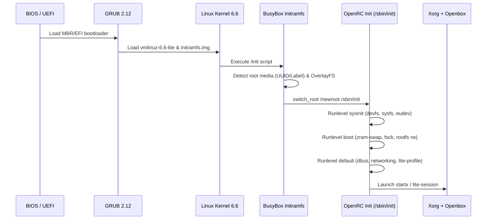

# Architecture Design Document (ADD) — Lite Office OS

## 1. System Philosophy
Lite Office OS is designed around strict resource conservation, predictable latencies, modularity, and deterministic reproducibility.

## 2. Kernel & Early Userspace Architecture

### 2.1 Kernel Configuration Strategy (`lite_defconfig`)
The kernel configuration strips away high-overhead enterprise features (e.g., virtualization host KVM, heavy btrfs/zfs filesystems, infiniband, legacy token-ring networking) and focuses exclusively on consumer desktop hardware:
- **Scheduler**: `CONFIG_SCHED_AUTOGROUP=y` (isolates terminal tasks from browser loads), `CONFIG_PREEMPT=y` (desktop responsiveness).
- **Memory Management**:
  - `CONFIG_ZRAM=y`, `CONFIG_ZRAM_DEF_COMP_ZSTD=y`.
  - `CONFIG_PAGE_REPORTING=y`, `CONFIG_MEMORY_BALLOON=y` (for virtualized testing).
  - Minimal kernel log buffer (`CONFIG_LOG_BUF_SHIFT=16` - 64 KB).
- **Core Storage Drivers**: AHCI (`CONFIG_SATA_AHCI=y`), NVMe (`CONFIG_BLK_DEV_NVME=y`), USB Mass Storage (`CONFIG_USB_STORAGE=y`).
- **Display Subsystem**: DRM KMS drivers for Intel (`CONFIG_DRM_I915=m`), AMD Radeon (`CONFIG_DRM_RADEON=m`, `CONFIG_DRM_AMDGPU=m`), and generic fallback (`CONFIG_DRM_SIMPLEDRM=y`).

### 2.2 Initramfs Design
The early userspace initramfs is created via an automated generator:
1. `init` script mounts `/dev`, `/proc`, `/sys`, `/run`.
2. Loads storage controller modules and DRM graphics modules.
3. Searches for boot media by UUID or filesystem label (`LITEOFFICE_LIVE`).
4. Mounts the root filesystem (or loop-mounts the `filesystem.squashfs` via overlayfs for Live ISO).
5. Executes `switch_root` to transition to the permanent root filesystem.



---

## 3. Init System & Services Architecture

### 3.1 OpenRC Runlevel Topology
- **`sysinit`**:
  - `devfs`: Mounts devtmpfs.
  - `dmesg`: Captures kernel boot messages.
  - `udev`: Spawns `eudevd` daemon and triggers coldplug device discovery.
- **`boot`**:
  - `zram-swap`: Reads total physical RAM via `/proc/meminfo`. If total RAM < 1 GB, configures `/dev/zram0` with 150% RAM size and `zstd` algorithm; sets `vm.swappiness=100`.
  - `sysctl`: Applies `99-lowmem.conf` (`vm.vfs_cache_pressure=50`, `vm.dirty_background_ratio=5`, `vm.dirty_ratio=10`).
  - `localmount`: Mounts partitions declared in `/etc/fstab`.
- **`default`**:
  - `dbus`: Minimal IPC message bus.
  - `network`: Starts `dhcpcd` or `connman`.
  - `earlyoom`: Launches lightweight OOM supervisor (`earlyoom -m 4 -s 10 -r 60 -n --avoid '(Xorg|openbox)'`).
  - `display-manager`: Spawns auto-login or LightDM to start X11 desktop session.

---

## 4. Desktop Environment & Shell Architecture

### 4.1 Modular Desktop Stack
- **Window Manager**: `Openbox` 3.6. Provides low-latency ICCCM/EWMH compliant window placement. Configured via `~/.config/openbox/rc.xml` with zero window drop-shadows and minimal animation overhead.
- **Panel & Taskbar**: `Tint2`. Configured with battery widget, volume slider (`volumeicon`), network indicator, clock, application launcher menu, and taskbar list. Consumes ~6 MB RAM.
- **Desktop & File Manager**: `PCManFM` with desktop manager enabled (`pcmanfm --desktop`). Provides desktop background, desktop icons, and efficient file operations without bulky GVfs daemons.
- **Appearance & Theming**: Flat, elegant GTK3 theme with clear typography, high contrast, and accessible system icons (`Papirus-Light` or `Adwaita-Slim`).

---

## 5. Memory Management Architecture

### 5.1 Dynamic Profile Engine (`lite-profile-detect`)
At session login, a profile script inspects `/proc/meminfo`:
```bash
RAM_KB=$(awk '/MemTotal/ {print $2}' /proc/meminfo)
if [ "$RAM_KB" -lt 800000 ]; then
    export LITE_PROFILE="low512"
    export DEFAULT_WORD_PROCESSOR="abiword"
    export DEFAULT_SPREADSHEET="gnumeric"
    export BROWSER="badger" # or single-process webkit
else
    export LITE_PROFILE="standard"
    export DEFAULT_WORD_PROCESSOR="libreoffice --writer"
    export DEFAULT_SPREADSHEET="libreoffice --calc"
    export BROWSER="firefox-esr"
fi
```
This ensures zero user intervention while guaranteeing the machine operates within its physical safety bounds.
